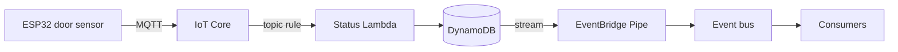

# Toilet Monitor

Event-driven backend for battery-powered door sensors (ESP32) reporting toilet occupancy.



Old implementations live in `_old/` (separate repos, not tracked here).

## Useful commands

- `bunx projen` - regenerate project files from `.projenrc.ts`
- `bunx projen build` - compile, test, bundle and synth
- `mise run diff [env]` - diff stacks against the deployed environment (default `dev`)
- `mise run deploy [env]` - deploy stacks to the environment (default `dev`)
- `mise run device:provision <env> <toiletId>` - create a device's thing and certificate, write its credentials to `~/.local/share/toilet-monitor/devices/<thingName>`
- `mise run device:deprovision <env> <toiletId>` - delete a device's certificates and thing

## Devices

Each device is a thing named `toilet-monitor-<env>-<toiletId>` with its own certificate. The `toilet-monitor-<env>-device`
IoT policy lets it connect over MQTT (port 8883) only with its thing name as the client ID, and publish only to its own
door topic `toilet-monitor/<env>/toilets/<thingName>/door`:

```json
{ "door": "open" | "closed", "reason": "change" | "heartbeat", "batteryMv": 3712 }
```

`reason` defaults to `change`, `batteryMv` is optional. HTTPS publishing isn't supported: the policy relies on
thing policy variables, which only resolve for MQTT connections.

## Events

Status changes are published to the `toilet-monitor-<env>` event bus with source `toilet-monitor` and detail types
`Toilet Status Changed`, `Toilet Went Offline` and `Toilet Came Online` (schema in `src/contracts/events.ts`). Every
event is also written to the `/aws/events/toilet-monitor/<env>/status-events` log group. Events can arrive out of order,
so consumers should rely on `changedAt` and `previous` in the detail.
