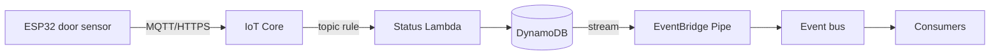

# Toilet Monitor

Event-driven backend for battery-powered door sensors (ESP32) reporting toilet occupancy.

Old implementations live in `_old/` (separate repos, not tracked here).

## Useful commands

- `bunx projen` - regenerate project files from `.projenrc.ts`
- `bunx projen build` - compile, test, bundle and synth
- `mise run diff [env]` - diff stacks against the deployed environment (default `dev`)
- `mise run deploy [env]` - deploy stacks to the environment (default `dev`)
